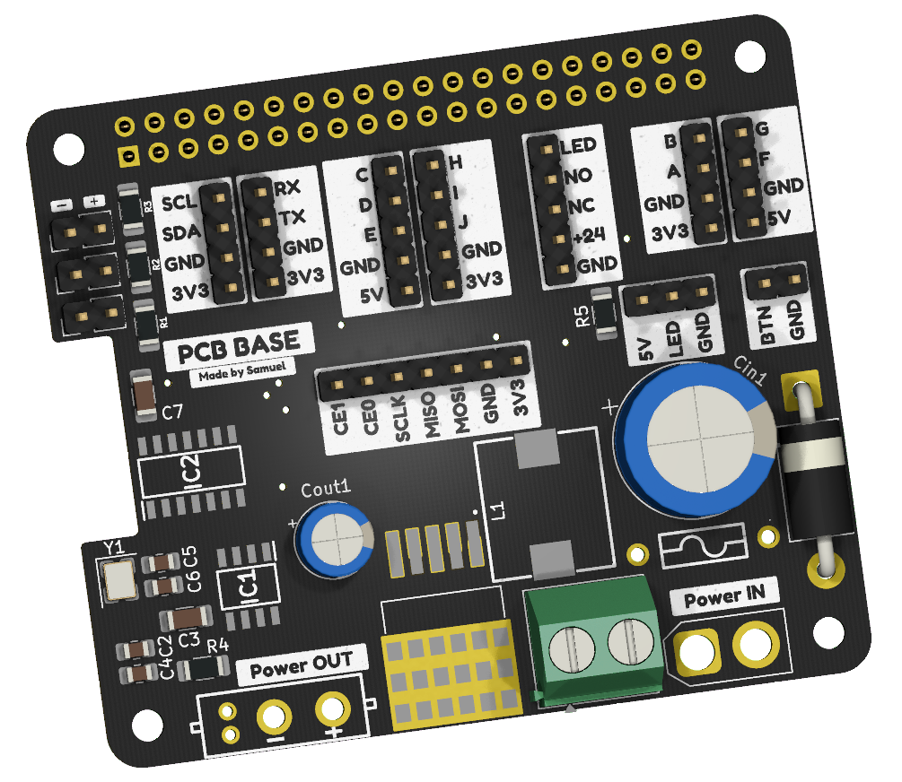
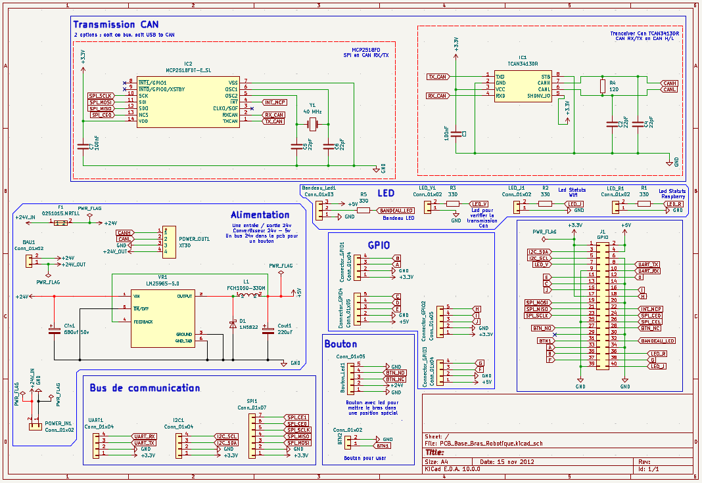
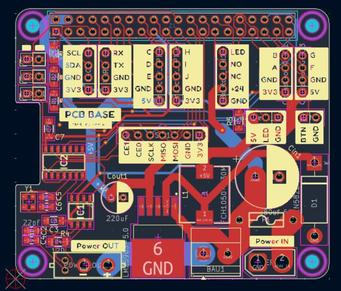
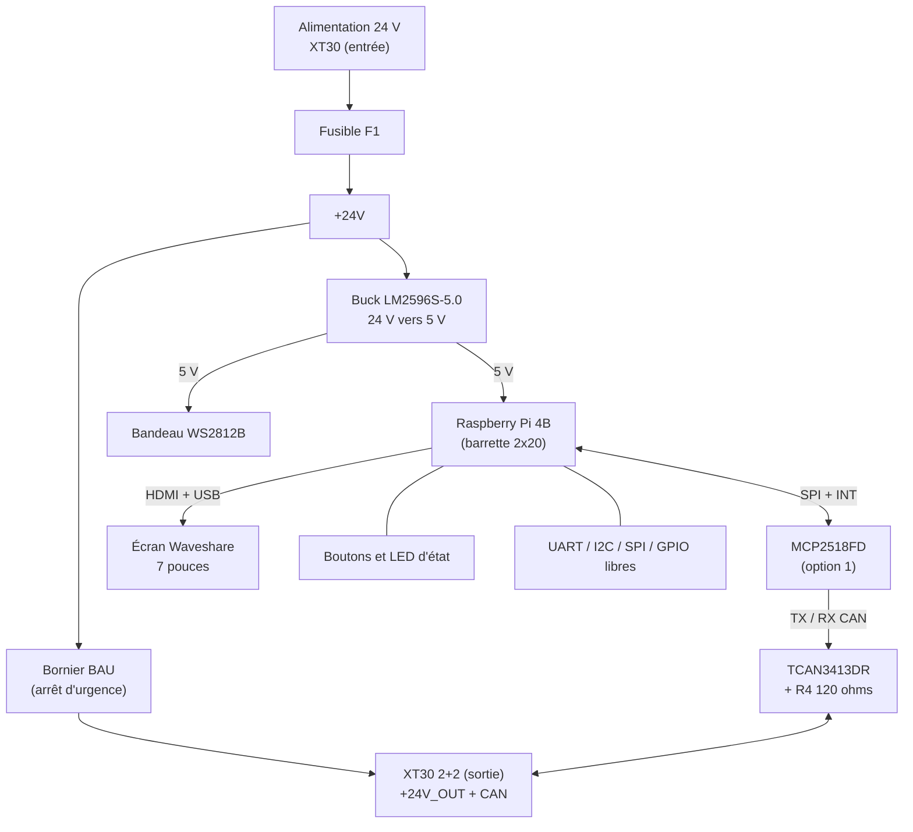

# Socle Raspberry Pi 4B 

Carte **socle** du bras robotique éducatif **EduArm** : elle accueille une **Raspberry Pi 4B**, distribue l'alimentation **24 V** et le bus **CAN** vers les drivers moteurs, génère le **5 V** de la Pi et regroupe les boutons, les LED et les connecteurs d'extension. Elle se place à la base du bras.



Conçue pour le projet **EduArm** (bras robotique éducatif).

[KiCad](https://img.shields.io/badge/KiCad-10.0-314cb0) [Couches](https://img.shields.io/badge/Carte-2%20couches-blue)


| **Auteur**  | Samuel_D_    |
| ----------- | ------------ |
| **Date**    | 18/11/2026   |
| **Version** | V1           |
| **Outil**   | KiCad 10.0.0 |

---
## Sommaire

1. [[#structure-du-dépôt|Structure du dépôt]]
2. [[#fonctionnalités|Fonctionnalités]]
3. [[#aperçu|Aperçu]]
4. [[#architecture|Architecture]]
5. [[#caractéristiques|Caractéristiques]]
6. [[#composants-principaux|Composants principaux]]
7. [[#protections-dentrée|Protections d'entrée]]
8. [[#connecteurs-et-interface|Connecteurs et interface]]
9. [[#brochage-du-raspberry-pi|Brochage du Raspberry Pi]]

---

## Structure du dépôt

```
.
├── README.md
├── SOCLE_RASPBERRY.kicad_pro
├── SOCLE_RASPBERRY.kicad_sch
├── SOCLE_RASPBERRY.kicad_pcb
├── lib/                  # symboles, empreintes et modèles 3D
├── production/
│   ├── gerbers/
│   ├── bom.csv
│   └── positions.csv
└── docs/
    ├── SOCLE_RASPBERRY_sch.pdf
    ├── SOCLE_RASPBERRY_routage.pdf
    └── img/
```

---

## Fonctionnalités

- Support d'une **Raspberry Pi 4B** sur barrette femelle 2×20 : les ports USB et Ethernet de la Pi restent accessibles.
- **Alimentation 24 V** : une entrée et une sortie 24 V, avec un bus 24 V interne à la carte pour le bouton d'arrêt d'urgence.
- **Arrêt d'urgence (BAU)** : il coupe uniquement le `+24V_OUT` (donc les moteurs). La Pi reste alimentée pour conserver les logs et analyser les erreurs éventuelles.
- **Buck 5 V** (LM2596S-5.0) qui alimente la Pi, le bandeau LED et les connecteurs 5 V.
- **Bus CAN** vers les drivers moteurs, avec **deux options** : soit MCP2518FD + TCAN3413DR (SPI vers CAN), soit un adaptateur USB-CAN externe. Une **terminaison 120 Ω** est présente sur la carte.
- **Bus de communication** exposés : UART, I2C et SPI.
- **10 GPIO libres** (`A` à `J`) répartis sur 4 connecteurs, en 3,3 V ou 5 V.
- **Boutons** : bouton utilisateur pour allumer l'écran, bouton lumineux pour mettre le bras dans une position spéciale.
- **LED d'état** : rouge (Raspberry), jaune (Wi-Fi), verte (transmission CAN), et **bandeau WS2812B** autour de la base du bras.
- **Écran** Waveshare 7" HDMI tactile, relié directement à la Pi (HDMI + USB).

## Aperçu

### Schématique



[SOCLE_RASPBERRY_SCH.pdf](/docs/Socle_Raspberry_SCH.pdf)

### PCB


[SOCLE_RASPBERRY_PCB.pdf](/docs/Socle_Raspberry_PCB.pdf)

### Rendu 3D


---
## Architecture



---

## Caractéristiques

| Paramètre              | Valeur                                                                      |
| ---------------------- | --------------------------------------------------------------------------- |
| Tension d'alimentation | **24 V DC** nominal (limite du LM2596 : 40 V maximum)                       |
| Sortie 5 V             | 5 V fixe, **3 A maximum** (LM2596S-5.0)                                     |
| Sortie 24 V            | Même 24 V que l'entrée, coupée par le BAU                                   |
| Pistes 24 V / GND      | 3 à 4,5 mm de large                                                         |
| Calculateur            | Raspberry Pi 4B (USB et Ethernet conservés)                                 |
| Bus CAN                | MCP2518FD (SPI) + TCAN3413DR (3,3 V), terminaison 120 Ω, ou USB-CAN externe |
| Quartz du MCP2518FD    | 40 MHz                                                                      |
| Bus exposés            | UART (1×04), I2C (1×04), SPI (1×07)                                         |
| GPIO libres            | 10 signaux (`A` à `J`) sur 4 connecteurs                                    |
| Écran                  | Waveshare 7" HDMI tactile capacitif, 1024×600                               |
| Carte                  | 2 couches                                                                   |

---

## Composants principaux

> Prix indicatifs relevés sur LCSC (novembre 2026), susceptibles de varier.

### Microcontroleur

**Raspberry Pi 4B** – enfichée sur une barrette femelle 2×20. Les ports USB et Ethernet sont ceux de la Pi. Elle est alimentée en 5 V par les broches 2 et 4 de la barrette.
### Écran

**Waveshare 7" HDMI tactile capacitif 1024×600** – [Kubii](https://www.kubii.com/fr/ecrans-supports/3789-ecran-lcd-tactile-capacitif-de-7-pouces-pour-raspberry-jetson-3272496312562.html) - 49€

| Liaison | Description |
|---|---|
| Liaison | HDMI (image) + USB (tactile et alimentation), branchés directement sur la Pi |
| Sur la carte | Seul le bouton `BTN1` (allumer l'écran) est relié à la carte |
### Alimentation 5 V

**LM2596S-5.0** (TWGMC) – régulateur buck 5 V fixe. [LCSC C5276750](https://www.lcsc.com/product-detail/C5276750.html) - 0.60€ l'unité

| Paramètre | Description |
|---|---|
| Entrée | 24 V (depuis `+24V`, avant le BAU) |
| Sortie | 5 V, 3 A maximum |
| Broche `ON/OFF` | Reliée à GND : régulateur toujours actif |
| Retour (`FEEDBACK`) | Relié à la sortie 5 V |
| Autonomie du 5 V | Reste alimenté quand le BAU est actionné 

| Réf.  | Composant                                                    | LCSC                                                            | Prix   |
| ----- | ------------------------------------------------------------ | --------------------------------------------------------------- | ------ |
| Cin1  | Condensateur 680 µF / 50 V                                   | [C48935384](https://www.lcsc.com/product-detail/C48935384.html) | –      |
| Cout1 | Condensateur 220 µF                                          | [C47344173](https://www.lcsc.com/product-detail/C47344173.html) | –      |
| L1    | Inductance FCH1050-330M, 33 µH                               | [C20415549](https://www.lcsc.com/product-detail/C20415549.html) | 1.31€  |
| D1    | Diode Schottky 1N5822 (ST), 40 V / 3 A, traversante DO-201AD | [C915962](https://www.lcsc.com/product-detail/C915962.html)     | 0.347€ |
### Transceiver CAN

Deux options sur la même carte :

|Option|Composants|
|---|---|
|1|**MCP2518FD** (SPI vers CAN-FD) + **TCAN3413DR** (transceiver 3,3 V)|
|2|Adaptateur **USB-CAN** externe (le bus CAN est le même, sur les lignes CANH / CANL)|

**TCAN3413DR** – transceiver CAN-FD 3,3 V. [LCSC C22433320](https://www.lcsc.com/product-detail/C22433320.html) - 1€ l'unité

**MCP2518FD** – contrôleur CAN-FD SPI (SOIC-14), [documentation Microchip](https://www.microchip.com/en-us/product/MCP2518FD#Documentation).

| Réf.   | Composant                         | LCSC                                                      | Prix    |
| ------ | --------------------------------- | --------------------------------------------------------- | ------- |
| Y1     | Quartz 40 MHz (YXC X322540MPB4SI) | [C9010](https://www.lcsc.com/product-detail/C9010.html)   | 0.1€    |
| C5, C6 | 22 pF (quartz)                    | –                                                         | –       |
| C7     | 100 nF (découplage MCP2518FD)     | [C24497](https://www.lcsc.com/product-detail/C24497.html) | 0.013€  |
| C3     | 100 nF (découplage TCAN3413DR)    | [C24497](https://www.lcsc.com/product-detail/C24497.html) | 0.013€  |
| R4     | 120 Ω (terminaison)               | [C17909](https://www.lcsc.com/product-detail/C17909.html) | 0.0044€ |
| C2, C4 | 22 pF (CANH / CANL vers GND)      | –                                                         | –       |
### Interface utilisateur

| Fonction                            | Connecteur            | Remarque                              |
| ----------------------------------- | --------------------- | ------------------------------------- |
| Bouton écran                        | `BTN2` (1×02)         | `BTN1` et `GND`                       |
| Bouton lumineux (position spéciale) | `Bouton_Led1` (1×05)  | Contact C / NO / NC + anneau LED 24 V |
| LED rouge                           | `LED_R1` (1×02)       | Statut de la Raspberry, via R1 330 Ω  |
| LED jaune                           | `LED_J1` (1×02)       | Statut du Wi-Fi, via R2 330 Ω         |
| LED verte                           | `LED_V1` (1×02)       | Transmission CAN, via R3 330 Ω        |
| Bandeau LED WS2812B                 | `Bandeau_Led1` (1×03) | `+5V`, donnée via R5 330 Ω, `GND`     |

Résistances 330 Ω (×4) : [LCSC C17930](https://www.lcsc.com/product-detail/C17930.html). Condensateurs 22 pF : taille CMS 0805 (×4).

---

## Protections d'entrée

L'alimentation 24 V traverse un fusible avant d'atteindre le buck et la sortie vers les moteurs.

|Composant|Référence|Rôle|
|---|---|---|
|**Fusible F1**|JK30-300. [LCSC C369106](https://www.lcsc.com/product-detail/C369106.html)|Coupe le circuit en cas de court-circuit ou de surintensité prolongée. Le calibre est à valider : un fusible traversant 15 A / 32 V est à l'étude (ex. Littelfuse 0251015.MXL, [LCSC C178934](https://www.lcsc.com/product-detail/C178934.html)).|
|**Bouton d'arrêt d'urgence**|Bornier `BAU1`|Coupe uniquement `+24V_OUT` (moteurs). Le 5 V de la Pi n'est pas coupé.|

> ***Pas de protection contre l'inversion de polarité*** : les connecteurs XT30 sont détrompés. Bien faire attention au cablage avant le premier branchement 

---

## Connecteurs et interface

### Alimentation et bus CAN

|Connecteur|Type|Rôle|
|---|---|---|
|`POWER_IN1`|XT30 (1×02)|Entrée 24 V|
|`BAU1`|Bornier (1×02)|Arrêt d'urgence|
|`POWER_OUT1`|XT30 (2+2)|Sortie 24 V + bus CAN|

`POWER_IN` :

|Broche|Signal|
|:-:|---|
|1|GND|
|2|+24V_IN|

`BAU` (contact du bouton d'arrêt d'urgence, en série sur le 24 V de sortie) :

|Broche|Signal|
|:-:|---|
|1|+24V_OUT|
|2|+24V|

`POWER_OUT` :

|Broche|Signal|
|:-:|---|
|1|CANH|
|2|CANL|
|3|GND|
|4|+24V_OUT|

### Bus de communication

|Connecteur|Broche 1|Broche 2|Broche 3|Broche 4|Broche 5|Broche 6|Broche 7|
|---|---|---|---|---|---|---|---|
|`UART1` (1×04)|+3,3V|GND|UART_TX|UART_RX||||
|`I2C1` (1×04)|+3,3V|GND|I2C_SDA|I2C_SCL||||
|`SPI1` (1×07)|+3,3V|GND|SPI_MOSI|SPI_MISO|SPI_SCLK|SPI_CE0|SPI_CE1|

### GPIO libres

|Connecteur|Broche 1|Broche 2|Broche 3|Broche 4|Broche 5|
|---|---|---|---|---|---|
|`Connector_GPIO1` (1×04)|+3,3V|GND|A|B||
|`Connector_GPIO2` (1×05)|+3,3V|GND|J|I|H|
|`Connector_GPIO3` (1×04)|+5V|GND|F|G||
|`Connector_GPIO4` (1×05)|+5V|GND|E|D|C|

### Boutons

`BTN2` (bouton utilisateur, écran) :

|Broche|Signal|
|:-:|---|
|1|BTN1|
|2|GND|

`Bouton_Led1` (bouton métallique 22 mm, 1 contact inverseur, anneau LED 24 V) :

|Catégorie|Broche|Signal|
|---|:-:|---|
|Anneau LED|1|LED+ (+24V)|
|Anneau LED|2|LED− (vers le drain d'un MOSFET piloté par `BTN_LED`)|
|Contact|3|C (GND)|
|Contact|4|NO (`BTN_NO`)|
|Contact|5|NC (`BTN_NC`)|

### LED d'état

|Connecteur|Broche 1|Broche 2|
|---|---|---|
|`LED_R1` (1×02)|GND|LED_R (via R1)|
|`LED_J1` (1×02)|GND|LED_J (via R2)|
|`LED_V1` (1×02)|GND|LED_V (via R3)|

`Bandeau_Led1` (1×03) :

|Broche|Signal|
|:-:|---|
|1|GND|
|2|BANDEAU_LED (via R5)|
|3|+5V|

---

## Brochage du Raspberry Pi

### Alimentation

|Signal|Broches J1|
|---|---|
|+3,3V|1, 17|
|+5V|2, 4|
|GND|6, 9, 14, 20, 25, 30, 34, 39|

### Écran

Aucune broche : l'écran est relié en HDMI et en USB directement sur la Pi.
### Boutons

|Signal|Broche J1|GPIO|
|---|:-:|---|
|`BTN_NO`|27|GPIO0|
|`BTN_NC`|28|GPIO1|
|`BTN_LED`|29|GPIO5|
|`BTN1`|31|GPIO6|
### LED

|Signal|Broche J1|GPIO|
|---|:-:|---|
|`LED_V`|7|GPIO4|
|`LED_R`|36|GPIO16|
|`LED_J`|40|GPIO21|
|`BANDEAU_LED`|32|GPIO12|
### Bus CAN (MCP2518FD)

| Signal     | Broche J1 | GPIO   |
| ---------- | :-------: | ------ |
| `SPI_MOSI` |    19     | GPIO10 |
| `SPI_MISO` |    21     | GPIO9  |
| `SPI_SCLK` |    23     | GPIO11 |
| `SPI_CE0`  |    24     | GPIO8  |
| `INT_MCP`  |    22     | GPIO25 |
### Bus de communication

| Signal     | Broche J1 | GPIO   |
| ---------- | :-------: | ------ |
| `I2C_SDA`  |     3     | GPIO2  |
| `I2C_SCL`  |     5     | GPIO3  |
| `UART_TX`  |     8     | GPIO14 |
| `UART_RX`  |    10     | GPIO15 |
| `SPI_MOSI` |    19     | GPIO10 |
| `SPI_MISO` |    21     | GPIO9  |
| `SPI_SCLK` |    23     | GPIO11 |
| `SPI_CE0`  |    24     | GPIO8  |
| `SPI_CE1`  |    26     | GPIO7  |
### GPIO libres

|Signal|Broche J1|GPIO|
|---|:-:|---|
|`A`|33|GPIO13|
|`B`|35|GPIO19|
|`C`|13|GPIO27|
|`D`|12|GPIO18|
|`E`|11|GPIO17|
|`F`|37|GPIO26|
|`G`|38|GPIO20|
|`H`|18|GPIO24|
|`I`|16|GPIO23|
|`J`|15|GPIO22|

---

_Samuel D – Projet EduArm – 2026_